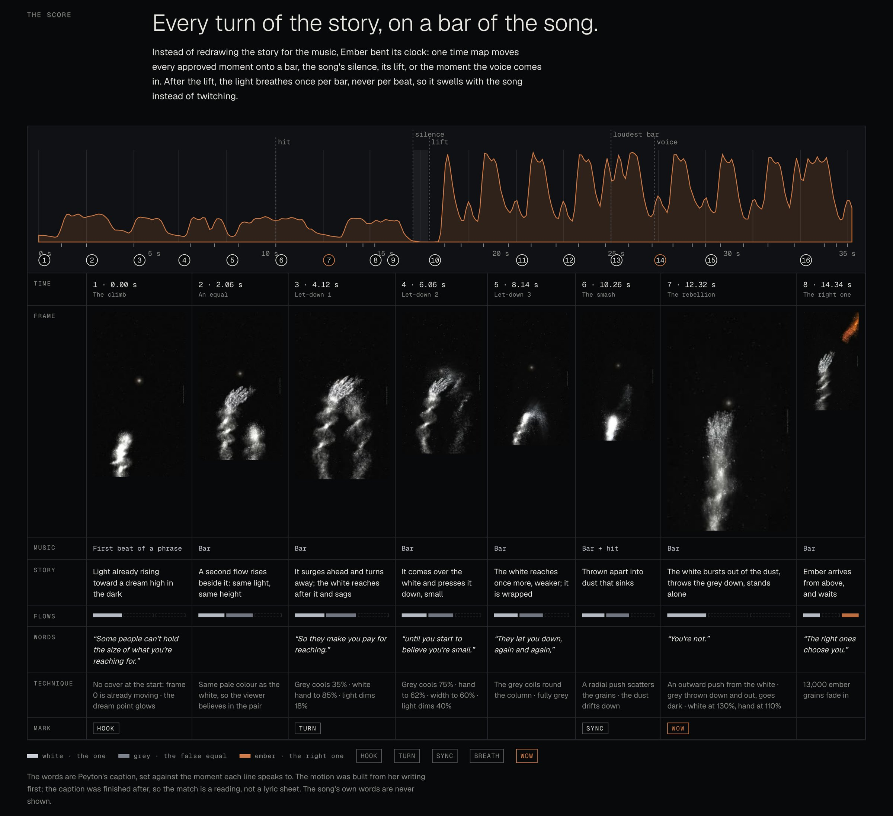
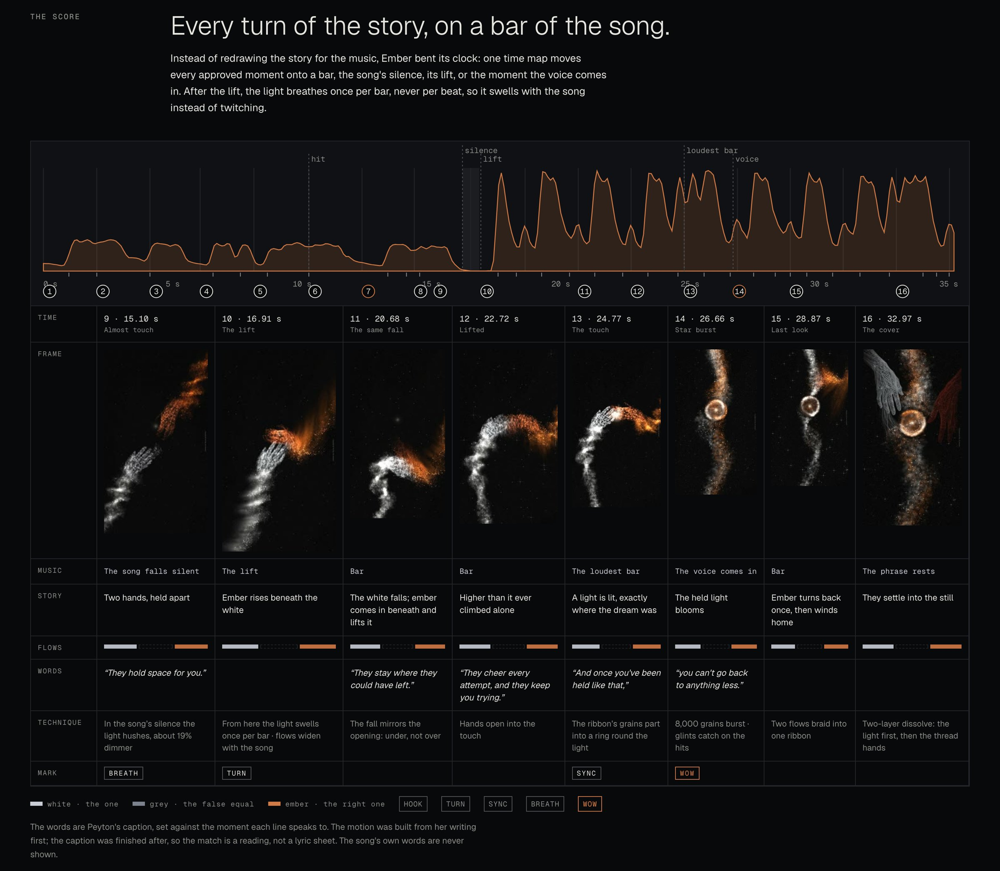

# Held Commitment: the score

Every turn of the story, on a bar of the song ("Unsteady", X Ambassadors, from 0:15.5; about 117 beats a minute, a bar every 2.05 s). The words are Peyton's caption, set against the moment each line speaks to; the motion was built from her writing first, so the match is a reading, not a lyric sheet. The song's own words are never shown.

| # | Time (s) | Music | Story | Words | Technique | Mark |
|---|---|---|---|---|---|---|
| 1 | 0.00 | First beat of a phrase | **The climb**: Light already rising toward a dream high in the dark | *Some people can't hold the size of what you're reaching for.* | No cover at the start: frame 0 is already moving · the dream point glows | HOOK |
| 2 | 2.06 | Bar | **An equal**: A second flow rises beside it: same light, same height |  | Same pale colour as the white, so the viewer believes in the pair |  |
| 3 | 4.12 | Bar | **Let-down 1**: It surges ahead and turns away; the white reaches after it and sags | *So they make you pay for reaching.* | Grey cools 35% · white hand to 85% · light dims 18% | TURN |
| 4 | 6.06 | Bar | **Let-down 2**: It comes over the white and presses it down, small | *until you start to believe you're small.* | Grey cools 75% · hand to 62% · width to 60% · light dims 40% |  |
| 5 | 8.14 | Bar | **Let-down 3**: The white reaches once more, weaker; it is wrapped | *They let you down, again and again,* | The grey coils round the column · fully grey |  |
| 6 | 10.26 | Bar + hit | **The smash**: Thrown apart into dust that sinks |  | A radial push scatters the grains · the dust drifts down | SYNC |
| 7 | 12.32 | Bar | **The rebellion**: The white bursts out of the dust, throws the grey down, stands alone | *You're not.* | An outward push from the white · grey thrown down and out, goes dark · white at 130%, hand at 110% | WOW |
| 8 | 14.34 | Bar | **The right one**: Ember arrives from above, and waits | *The right ones choose you.* | 13,000 ember grains fade in |  |
| 9 | 15.10 | The song falls silent | **Almost touch**: Two hands, held apart | *They hold space for you.* | In the song’s silence the light hushes, about 19% dimmer | BREATH |
| 10 | 16.91 | The lift | **The lift**: Ember rises beneath the white |  | From here the light swells once per bar · flows widen with the song | TURN |
| 11 | 20.68 | Bar | **The same fall**: The white falls; ember comes in beneath and lifts it | *They stay where they could have left.* | The fall mirrors the opening: under, not over |  |
| 12 | 22.72 | Bar | **Lifted**: Higher than it ever climbed alone | *They cheer every attempt, and they keep you trying.* | Hands open into the touch |  |
| 13 | 24.77 | The loudest bar | **The touch**: A light is lit, exactly where the dream was | *And once you've been held like that,* | The ribbon’s grains part into a ring round the light | SYNC |
| 14 | 26.66 | The voice comes in | **Star burst**: The held light blooms | *you can't go back to anything less.* | 8,000 grains burst · glints catch on the hits | WOW |
| 15 | 28.87 | Bar | **Last look**: Ember turns back once, then winds home |  | Two flows braid into one ribbon |  |
| 16 | 32.97 | The phrase rests | **The cover**: They settle into the still |  | Two-layer dissolve: the light first, then the thread hands |  |

Marks: HOOK the first two seconds · TURN the story changes direction · SYNC a movement lands on a beat or cue · BREATH nothing happens on purpose · WOW a surprise.

© 2026 Peyton. All rights reserved.
