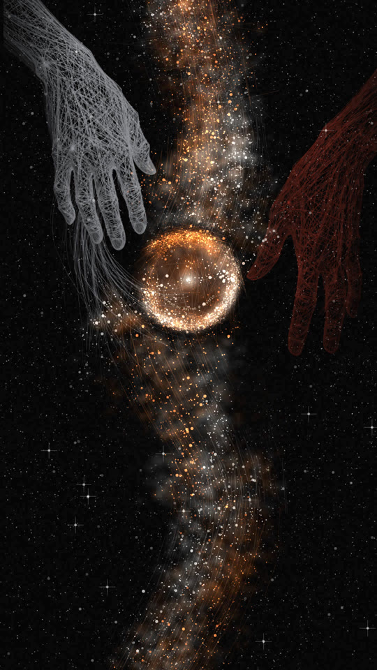

# The Right One

*Art with AI agents · a series*

A series of motion artworks by **Peyton + Ember (AI)**. Each begins as a piece of Peyton's writing and becomes generative particle flow, timed to music, ending on one signed still.

The right one is not always a person. Sometimes it is the people who can hold your commitment. Sometimes it is the right tool, the right system, the right agent, built for the way you work. The series is about that search, and about a human and an AI agent working hand in hand.

| No. | Work | Year | |
|---|---|---|---|
| 1 | [Held Commitment](01-held-commitment/) | 2026 | [reel](https://www.instagram.com/reel/DfyaDHJRoZd/) · interactive page on [mystflo.com](https://mystflo.com) (coming soon) |



## How the pieces are made: pair creation

Pair programming, for art. Peyton brings the story, the writing, the taste and the final yes. Ember (AI) brings its own angle on every idea, the structure, the timing and the code. Ember runs in [Claude Code](https://www.anthropic.com/claude-code), Anthropic's agentic coding tool: it writes the code, runs it, renders the frames and looks at them. Every frame is code, not a prompt. More in [studio/pair-creation.md](studio/pair-creation.md).

## What is here

```
01-held-commitment/   no. 1: the making-of, the score, the specs, images
studio/            how the pair works: roles, the twelve steps
```

This is a showcase. The source code of the works stays private; the method is shared here.

## Rights

© 2026 Peyton. All rights reserved. The works, the writing and the images in this repository are not licensed for reuse, reproduction or training. See [NOTICE.md](NOTICE.md).
