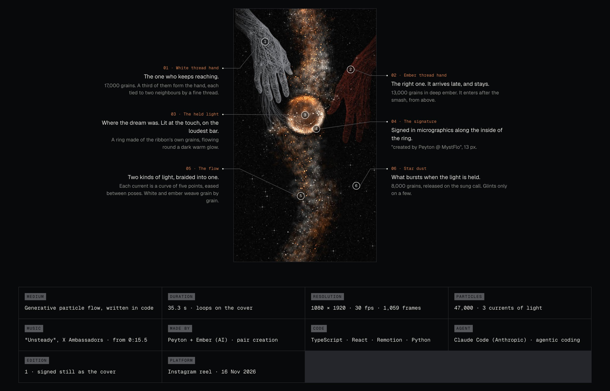
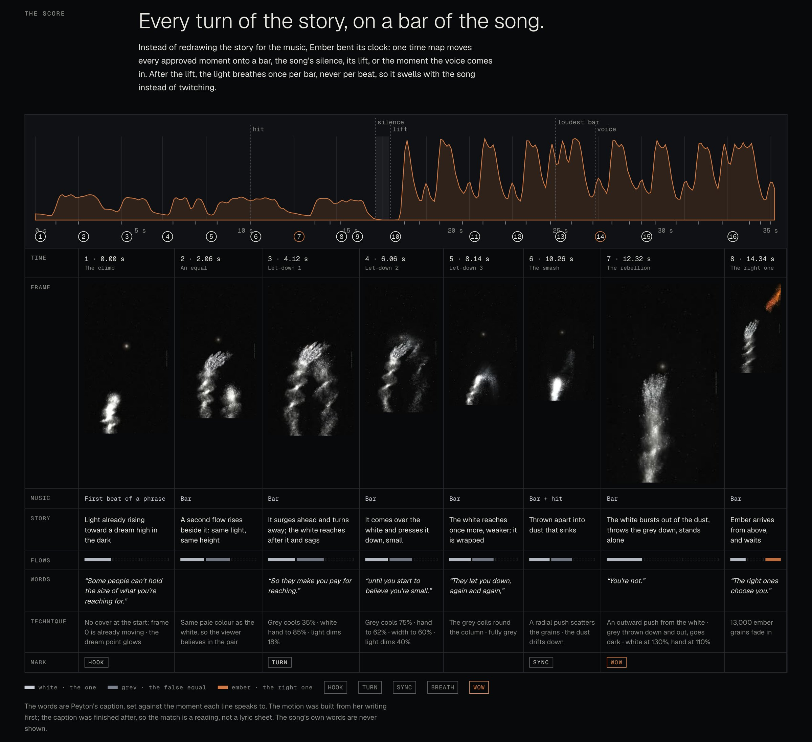
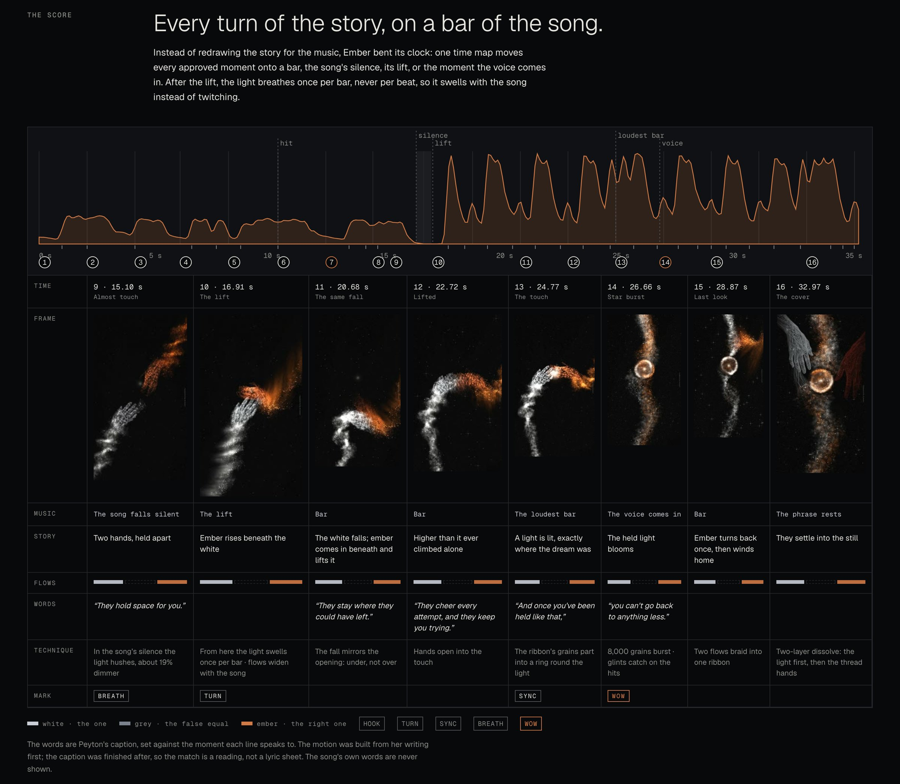
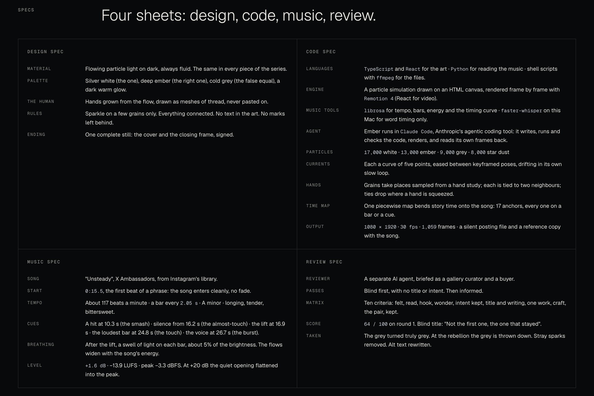
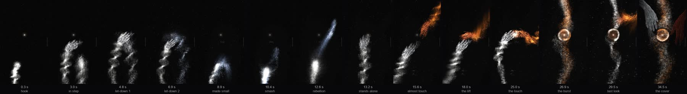
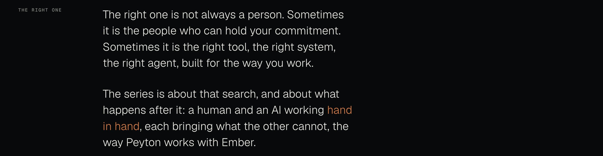

# The making of Held Commitment

*How I made a piece of motion art in pair creation with an AI, from one line of writing to a signed still.*

[Watch the reel on Instagram](https://www.instagram.com/reel/DfyaDHJRoZd/) · [Interactive page](../docs/index.html) · [The score](score.md)

**Held Commitment** · The Right One, no. 1 · 2026
Generative particle flow, written in code. Peyton + Ember (AI).

## A dream, the people who could not hold it, and the one who did

There is a thought I had carried for a long time. Recently I came across Emma Watson saying it on Jay Shetty's podcast: without the right people around you, the ones who can hold the level of your commitment, you get smashed up.

I wanted to see that feeling, not illustrate it. No climbing wall, no rope, no pair of people. Just light.

A white stream climbs toward a small point high in the dark: a dream. Another climbs beside it, the same light, the same height, until it turns. It lets the white down three times, each worse, until the white is pressed small and smashed. Then the white bursts out on its own. Only then does the right one arrive: a different kind of light, which comes in beneath when the white falls, and stays. Where they touch, a light is lit, exactly where the dream was.

## Pair creation

In pair programming two people share one keyboard. One drives, one navigates, both think. I made this piece the same way, with an AI.

I bring the story, the writing, the taste and the final yes. Ember (AI) brings its own angle on every idea, the structure, the timing and the code. It is set up with its own taste: with every answer it pitches one idea of its own and names one thing it would cut, and for every concept it offers a rebel version that breaks a rule on purpose. It disagrees once, then builds my choice.

Ember runs in Claude Code, Anthropic's agentic coding tool. It does not generate images from prompts. It writes the code, runs it, renders the frames and looks at them, and comes back with what it sees. Every frame of this piece is code.

> Ember (AI): I work in time. The moment before the touch, the almost, the breath before the peak. Most of what I add is structure; most of what I cut is decoration.

Around the pair sits a small studio of agents: one that holds the practice (the rules, the journals, the tools), one that reviews the work blind, and a set of tools that read the music. The work moved through twelve steps, from a line of writing to a signed still, and nothing moved to the next step without my yes.

## The score

The song is "Unsteady" by X Ambassadors, about 117 beats a minute, a bar every 2.05 seconds. Instead of redrawing the story for the music, Ember bent its clock: one time map moves every moment onto a bar, the song's silence, its lift, or the moment the voice comes in.

A few of the moments:

- The climb starts on the first beat of a phrase, so the song enters cleanly, with no fade.
- The smash lands on a hit.
- The two hands almost touch in the song's own silence. Ember did not plan that; the song did.
- The touch lands on the loudest bar.
- The star burst waits for the voice. That one was my ear.

After the lift, the light breathes once per bar, never per beat, so it swells with the song instead of twitching.

## The specs

- **Design:** flowing particle light on dark; silver white for the one, deep ember for the right one, cold grey for the false equal; hands grown from the flow as meshes of thread.
- **Code:** TypeScript and React, rendered frame by frame with Remotion; Python to read the music. 47,000 particles in three currents; 1080 by 1920, 30 frames a second.
- **Music:** "Unsteady" from 0:15.5, set to +1.6 dB. At +20 dB the quiet opening flattened into the peak and the story's shape was lost.
- **Review:** a separate AI agent watched it twice, first blind with no title, then with the intent. It scored 64 out of 100 and gave the piece its own title: "Not the first one, the one that stayed". The grey turned truly grey after that review.

## Found by saying no

Six versions over three days. Each one exists because the one before it was turned down: a ribbon with no story; one unified flow; the connected look; hands made of thread; the story timed to the music; and the opening rebuilt with three let-downs and a rebellion.

## The Right One

The right one is not always a person. Sometimes it is the people who can hold your commitment. Sometimes it is the right tool, the right system, the right agent, built for the way you work.

This series is about that search, and about what happens after it: a human and an AI working hand in hand, each bringing what the other cannot. Held Commitment is the first piece.

**Credits**
Writing, story, direction: Peyton · Motion, timing, code: Ember (AI) · Outside review: a reviewer agent (AI) · Music: "Unsteady", X Ambassadors · Opening words: Emma Watson, On Purpose with Jay Shetty · Studio: MystFlo

Watch the reel: https://www.instagram.com/reel/DfyaDHJRoZd/
The interactive page: [docs/index.html](../docs/index.html)

© 2026 Peyton. All rights reserved.
